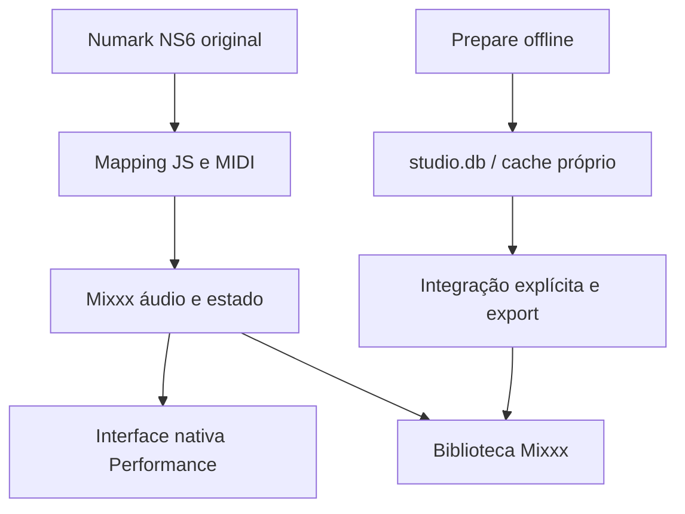

# Arquitetura e desempenho

A pesquisa de 25/11/2026 recomendou Mixxx 2.5.6 + XML/QSS/SVG + JS para primeiro MVP; a experiência visual posterior mostrou que é necessário reavaliar o custo de obter qualidade Apple nesse stack. QML/Qt Quick é alternativa a investigar, não escolha validada. Evitar Chromium no caminho Performance. Motor Mixxx C++ preservado. A UI 3D WebGL é protótipo isolado, não frontend de áudio.

Nunca escrever diretamente na SQLite ativa do Mixxx. Worker separado e limitado, análise offline/suspensa durante performance. Waveform nativa, cache incremental, listas virtualizadas, nenhum ML/IO/alocação ou bloqueio novo no callback áudio. Preservar 14-bit, scratch/backspin, timers, takeover, reconexão e LEDs. Licenças GPL/dependências/modelos e direitos do mapping/manual têm de ser verificados antes de publicação.

## Metas (não resultados)
60 FPS, p95 frame ≤16,7 ms; Browse <100 ms, pesquisa 10k <50 ms / 100k <150 ms / 1M <500 ms; load SSD p95 <500 ms; cold start <8s; zero xruns em 4h de quatro decks, soak 8h. Medir p50/p95/p99, CPU/RAM/GPU, MIDI→audio/UI, loopback, disco, startup; comparar stock vs candidato. Testar 64/128/256/512 frames. Windows 10 driver NS6 oficial 2.9.64 foi recomendação histórica da pesquisa, não indicação de segurança/suporte atual do SO. Windows 11/macOS modernos têm limitações oficiais NS6 original; Linux driver comunitário experimental. Verificar hardware real.

## Roadmap de referência
1. Baseline físico 4 decks, áudio master/headphones, estabilidade e drivers.
2. Freeze mapping e regressões.
3. Aprovar visual e escolher stack nativo (XML/QSS ou QML), Player/Browse.
4. Tag List e CDJ parity; testes sem rato e layers.
5. Prepare v1, Track DNA, Smart Cues, Transition, stems.
6. Interoperabilidade USB e migração QML conforme upstream.

Nenhuma fase é uma tarefa em execução. O código anterior é arquivo histórico.
