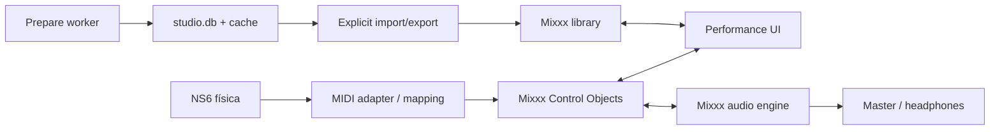

# Arquitetura e contratos técnicos

Estado: proposta de referência, não stack aprovada. Pesquisa de novembro de 2026 favorecia XML/QSS 2.5.6; tentativa de execução comprovou apenas arranque virtual e falhou visualmente na avaliação do utilizador. QML é hipótese futura a validar, não solução garantida.

## 1. Boundaries

Performance usa um motor e uma representação autoritativa do estado. UI nunca mantém cópia divergente de playposition, rate ou playback. Eventos de UI enviam intenção via control validado; engine publica estado. Não criar socket/IPC no caminho de áudio; se companion existir, contratos versionados, fila limitada e falha isolada. Worker não depende de Performance para completar tarefas; Performance funciona se worker estiver desligado.

## 2. Alternativas
| Opção | Benefício | Tradeoff | Decisão |
|---|---|---|---|
| XML/QSS/SVG stock | integração nativa, rápido arranque experimental | layout/widget styling e extensibilidade limitados, design anterior rejeitado | arquivada como prova técnica |
| Qt Quick/QML interno | liberdade visual e componentes reusáveis | maturidade upstream, biblioteca/preview/scaling e build | spike futuro, medir |
| Fork C++/QML | controle total | manutenção upstream, GPL, testes e distribuição | só com caso comprovado |
| Web UI + bridge | facilidade de UI | renderer/IPC/deploy extra | não para live sem evidência superior |
| Companion Prepare | independência e isolamento | sincronização/formatos e licenças | proposta |

Não assumir QML disponível e estável numa release sem verificar upstream. Pinar versão e commit, documentar build/reproducibilidade e licença. Não vender Windows 10 como solução segura atual sem rever suporte; verificar drivers e SO antes de recomendar.

## 3. Contratos de estado
DeckSnapshot {deck_id:1..4, track_id|null, loaded, playing, audible/on_air, pfl, bpm_original?, bpm_visual?, pitch_ratio, key?, elapsed_samples, duration_samples?, cue?, loop_state, quantize, keylock, slip, sync, peak, fx_routes[]}. UI trata desconhecido como desconhecido; estado visual é derivado de control objects validados. HardwareLayerSnapshot {left:1|3,right:2|4,shift_left,shift_right,connected,generation}. LibrarySelection {source_id, selected_track_id?, sort, query, scroll_anchor, availability}. Commands: SelectScreen, ToggleLayout, SelectLibraryItem, PreviewStart/Stop, RequestLoad(deck_id,track_id,origin), AddTag/RemoveTag, CueAction. Validar deck/layer antes de load e tratar sucesso/erro; não confundir track selecionado com track carregado. Estado e nomes aqui são contrato conceptual; mapear para APIs existentes, não inventar control IDs.

## 4. Real-time
Audio callback: sem filesystem, rede, alocação/bloqueios novos, ML, logging massivo, consultas DB ou Qt UI. Engine Mixxx mantém thread/driver. UI frame pacing e audio buffer são métricas separadas; atrasos de UI não podem parar áudio. Coalescer eventos de alta frequência por frame visual; não descartar release/transport. Nunca sincronizar hardware por polling agressivo. Waveform nativa e uma instância por deck quando possível. Prepare suspenso em live; jobs retomáveis.

## 5. Cache / escala
Library nativa para MVP, virtualização e busca incremental. Se DB própria: B-tree para campos/ranges, FTS5, paginação/virtualização, nenhum decode artwork por milhares de rows. Cache waveform multiresolução offline (64/256/1024 samples/pixel + overview como valores a validar), key versionado. Limites de cache e eviction preservando dados manuais. Rebuild não altera dados do utilizador. DB migrations transacionais, backup antes de upgrade, recuperação de crash e schema versionado.

## 6. Distribuição
Windows/Linux/macOS: separar suporte de UI e da interface de áudio NS6 original. Testar master/headphones e reconexão com o driver correto. Build reproducível, dependências e licenças inventariadas. Mixxx GPLv2+ (confirmar distribuição), modelos e fontes com licenças próprias. Não redistribuir firmware/drivers/manuais/fontes proprietários sem direitos. Não colocar biblioteca real, áudio, keys ou passwords no Git. Perfis de teste isolados; rollback a stock. Nenhuma release no arquivo atual.
